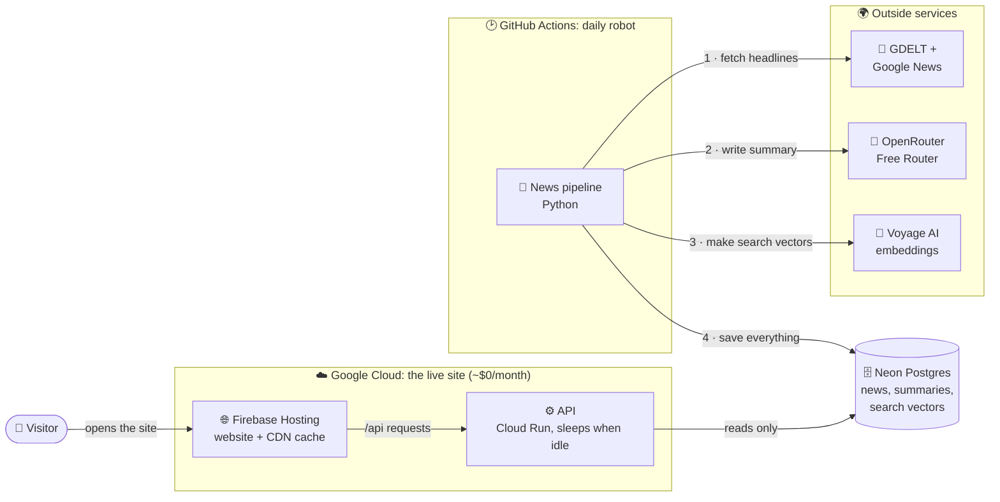
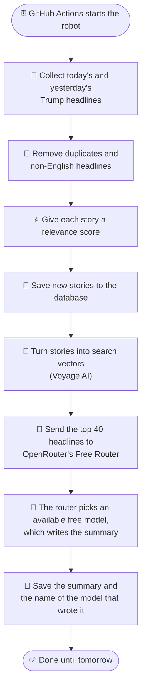
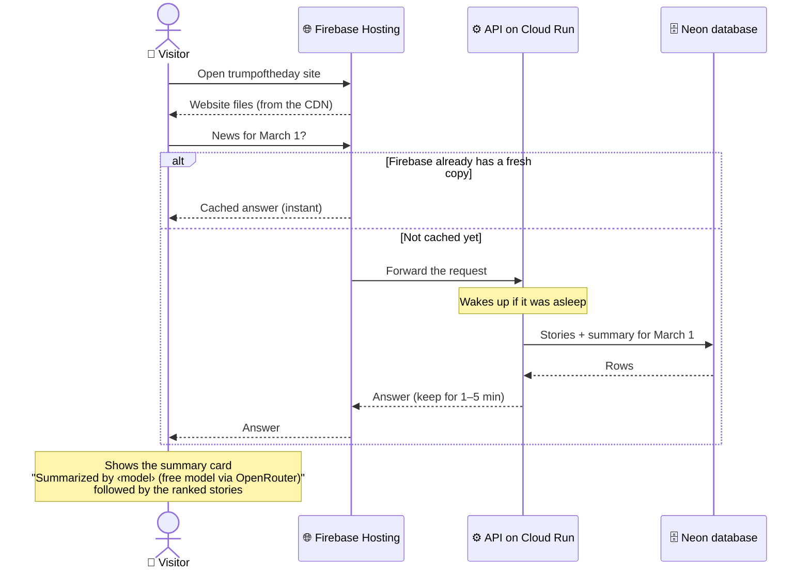
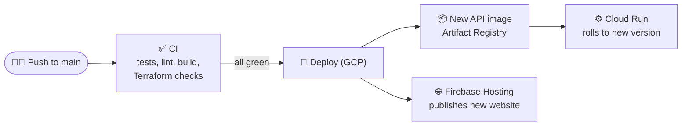
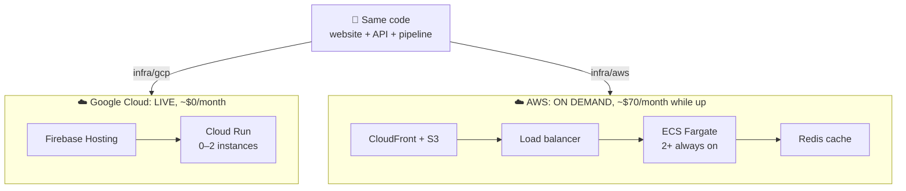

# Architecture

A high-level picture of how Trump of the Day works. For the details (caching rules, failure handling, design decisions), see [docs/architecture.md](docs/architecture.md).

The whole system does two jobs:

1. **Once a day**, a robot collects the day's news, ranks it, and asks a free AI model to write a short summary.
2. **All day**, visitors open the site and read whatever the robot saved.

---

## 1. The big picture

| Piece | In one sentence |
|---|---|
| **Firebase Hosting** | Serves the website and keeps copies of recent answers, so most visits never wake the API. |
| **API (Cloud Run)** | A small server that answers "what's the news for this day?" and shuts itself off when nobody is asking. |
| **Neon Postgres** | The database: every article, each day's summary, and the vectors that power search. |
| **News pipeline** | Runs once a day on GitHub's computers: scrapes, ranks, summarizes and saves. |
| **OpenRouter Free Router** | Picks a free AI model to write the day's summary. The site shows which model wrote it. |
| **Voyage AI** | Turns each headline into numbers that capture its meaning, so search can match on meaning rather than exact words. |

---

## 2. What happens every day at 14:00 UTC

If the AI step fails, the day still gets its news list, just without a summary.

---

## 3. What happens when someone opens the site

---

## 4. How a code change goes live

GitHub logs into Google Cloud with **Workload Identity Federation**: a short-lived pass issued per run, so no password or key is stored anywhere.

---

## 5. Two clouds, same app

The application code is identical. Only where it runs differs, and both are described in Terraform.

| | Google Cloud (live) | AWS (on demand) |
|---|---|---|
| Purpose | Run the real site cheaply | Show the full, always-on version for demos and load tests |
| Cost | About $0/month | About $2.30 per day while it's up |
| Scales by | Starting instances on demand, down to zero | Keeping 2+ servers running, adding more under load |
| Extras | — | Redis cache, live updates over WebSockets |
| Turn on / off | Always on | `terraform apply` / `terraform destroy` |

More detail: [infrastructure](docs/infrastructure.md) · [costs](docs/costs.md) · [API](docs/api.md) · [load tests](docs/load-testing.md)
