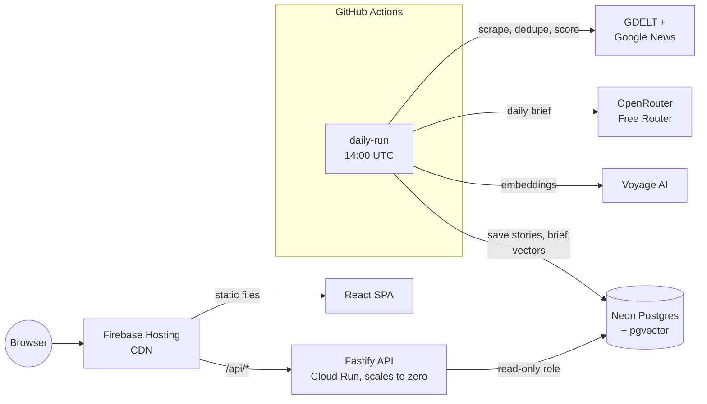

# Trump of the Day🦅
 <em>What did he do today?</em>

A daily archive of news about Donald Trump and his administration: pick a day on the calendar to see that day's coverage, led by a short AI-written brief of the top stories.

## Features

- Interactive calendar for date selection (keyboard accessible, UTC day boundaries that match the pipeline)
- A daily brief: a neutral AI-written summary of the day's top stories, which are highlighted in the feed. Every sentence cites its sources with numbered links that jump to the story cards below, and the card names the model that wrote it (for example `upstage/solar-pro-3`, a free model via OpenRouter)
- Stories ranked by relevance rather than scrape order
- Semantic search across the whole archive, and "related coverage" for any story (pgvector)
- Live updates: open pages refresh when the daily pipeline publishes new stories (WebSockets; on the AWS and local stacks)
- Distinct loading, empty and error states, with retry
- Dark mode and light mode with system preference detection
- Responsive design for mobile and desktop

## Architecture

The live site runs on GCP for about $0/month. The same app also has a full AWS stack in Terraform, brought up on demand for demos and load tests ([costs](docs/costs.md), [infrastructure](docs/infrastructure.md)).



On AWS the same API runs on ECS Fargate behind an ALB and CloudFront, with ElastiCache Redis and WebSocket live updates.

| Path | What it is |
|---|---|
| [`src/`](src/) | React + TypeScript + Tailwind frontend (Vite) |
| [`api/`](api/) | Fastify API: cached news queries, search, health checks, WebSocket live updates |
| [`trump-of-the-day-server/`](https://github.com/harshaldafade/trump-of-the-day-server) | Git submodule: the Python news pipeline (scraper, relevance scoring, daily brief, embeddings) and the database schema |
| [`infra/gcp/`](infra/gcp/) | Live infrastructure: Cloud Run, Firebase Hosting, Secret Manager, Artifact Registry, Workload Identity Federation, budget and uptime alerts |
| [`infra/aws/`](infra/aws/) | On-demand AWS stack: VPC, ECS Fargate, ALB, ElastiCache, S3 + CloudFront, IAM with GitHub OIDC, alarms |
| [`loadtest/`](loadtest/) | k6 load tests (HTTP and WebSocket) and seed data for the local stack |
| [`docs/`](docs/) | Architecture, API, infrastructure, development and load-testing docs |

The browser never talks to the database. Earlier versions queried Neon directly from the browser with a read-only connection string compiled into the JavaScript bundle; see the [changelog](CHANGELOG.md).

### The daily brief

Each day the pipeline sends the top 40 headlines to OpenRouter's [Free Router](https://openrouter.ai/docs/guides/routing/routers/free-router) (`openrouter/free`), which picks an available free model that supports structured output. The pipeline saves the name of the model that actually answered next to the summary, and the site shows it on the card. If the brief can't be written, the day still gets its ranked story list.

| Setting (pipeline) | Effect |
|---|---|
| `OPENROUTER_API_KEY` | Turns on the brief via the Free Router (default provider when set) |
| `OPENROUTER_MODELS` | Optional comma-separated model ids to use instead of the router |
| `DIGEST_PROVIDER=anthropic` + `ANTHROPIC_API_KEY` | Use Claude instead (`ANTHROPIC_MODEL`, default `claude-opus-5-5`) |
| `VOYAGE_API_KEY` | Turns on embeddings for search and related coverage |

All of these are optional: without them the pipeline still scrapes, ranks and saves the news. See [docs/costs.md](docs/costs.md#daily-brief-options) for what each option costs.

### Load test results

Measured with k6 against the API backed by a stub database (10 connections, 15 ms per query); see [docs/load-testing.md](docs/load-testing.md).

| Scenario | Result |
|---|---|
| HTTP, no cache | 320 req/s, p95 2,927 ms (database pool saturated) |
| HTTP, with cache | 800 req/s, p95 1.1 ms |
| WebSockets | 2,000 concurrent clients, p95 round trip 1 ms, 13,912 broadcasts delivered |

## Getting Started

```bash
git clone --recurse-submodules git@github.com:divij-pawar/trump-of-the-day.git
cd trump-of-the-day
docker compose up --build     # Postgres + pgvector (seeded), Redis, API on :8080
npm install
npm run dev                   # frontend on :5173, proxies /api and /ws to :8080
```

Prerequisites: Node.js 22+, Docker. See [docs/development.md](docs/development.md) for running against a real Neon database, running the pipeline, and running the tests.

## Documentation

- [ARCHITECTURE.md](ARCHITECTURE.md): the high-level picture in five diagrams (start here)
- [docs/architecture.md](docs/architecture.md): how the pieces fit, caching and live updates, design decisions
- [docs/api.md](docs/api.md): API endpoints and the WebSocket protocol
- [docs/infrastructure.md](docs/infrastructure.md): both Terraform stacks, IAM design, health checks, first deploy
- [docs/costs.md](docs/costs.md): what each service costs and why it was chosen
- [docs/development.md](docs/development.md): local setup, tests, CI, working with the submodule
- [docs/load-testing.md](docs/load-testing.md): k6 scenarios and results
- [CHANGELOG.md](CHANGELOG.md)
- Pipeline docs live in the submodule: [trump-of-the-day-server/README.md](trump-of-the-day-server/README.md)

## Technologies Used

- React, TypeScript, Tailwind CSS, Vite, Vitest
- Fastify, Redis (ioredis), node-postgres, WebSockets
- Neon (serverless Postgres) with pgvector
- Python pipeline: GDELT, Google News RSS, OpenRouter free models (or Claude) for the daily brief, Voyage AI embeddings
- Terraform on GCP: Cloud Run, Firebase Hosting, Secret Manager, Artifact Registry, Cloud Monitoring, billing budgets
- Terraform on AWS: ECS Fargate, ALB, ElastiCache, S3, CloudFront, Secrets Manager, CloudWatch
- GitHub Actions (CI, keyless deploys via GCP Workload Identity Federation and AWS OIDC), k6

## License

This project is licensed under the MIT License.
