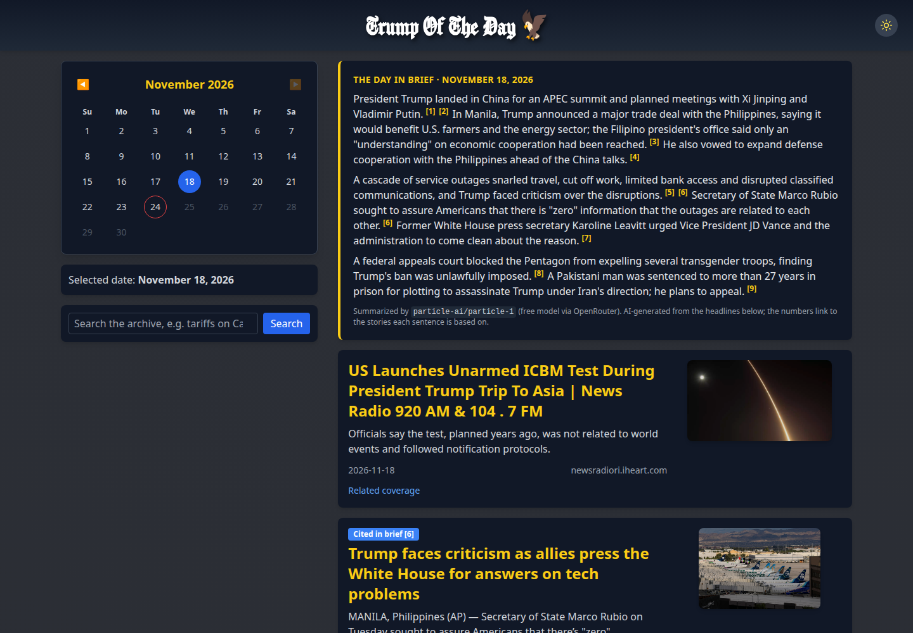
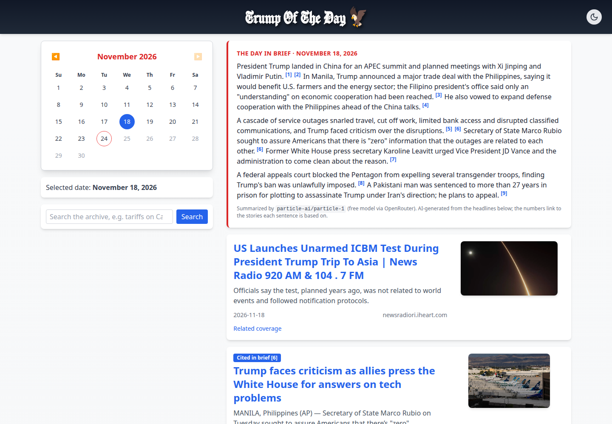
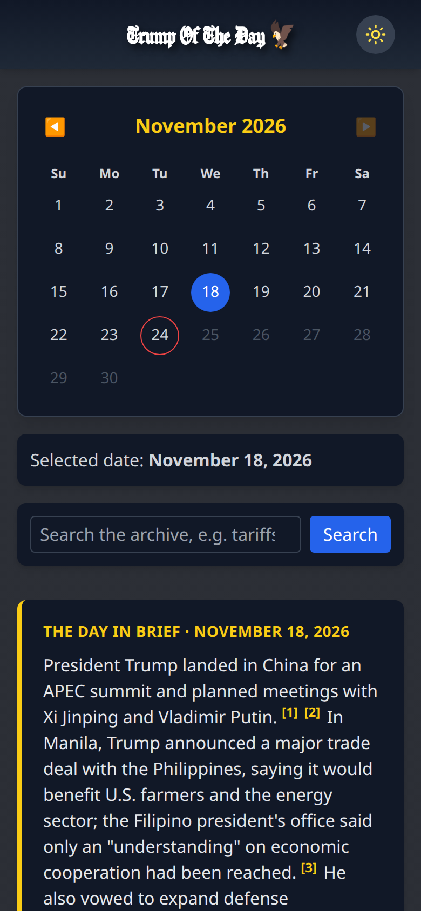
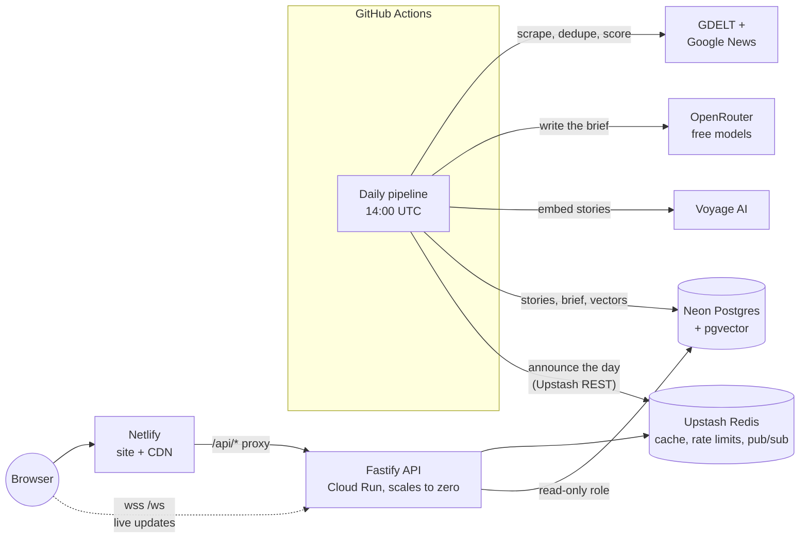
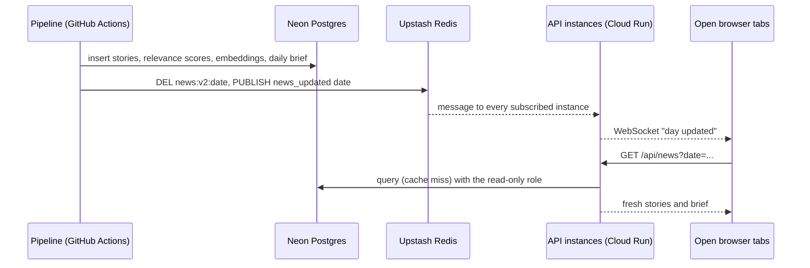

<div align="center">

# Trump of the Day 🦅

**What did he do today?**

A daily archive of news about Donald Trump and his administration. Pick a day on the calendar and read that day's coverage, led by a short AI-written brief in which every sentence links to the stories it came from.

[](https://github.com/divij-pawar/trump-of-the-day/actions/workflows/ci.yml)


-7b42bc)

[](LICENSE)

[Live site](https://trumpoftheday.com) · [Architecture](ARCHITECTURE.md) · [Setup guide](docs/setup.md) · [Docs](#documentation)

 

</div>

## What it is

Trump of the Day is a full-stack news archive that updates itself. Every day a pipeline collects the day's coverage, ranks it, has a free LLM write a neutral summary with citations, and stores everything in Postgres. A small API serves it, and open browser tabs update live when new stories land.

It started as a React page that queried a database directly from the browser. It is now a three-tier system with an API in the middle, infrastructure defined in Terraform, keyless deploys, tests at every layer, and a monthly bill of about zero. This repository holds the website, the API and the infrastructure; the data pipeline lives in its own repository, included here as a submodule: [trump-of-the-day-server](https://github.com/harshaldafade/trump-of-the-day-server).

## Features

- **A daily brief with citations.** A neutral, AI-written summary of the day's top stories. Every sentence carries numbered links that jump to the story cards, the cited cards are marked, and the card names the model that wrote it.
- **Ranked, not just scraped.** Stories are scored for relevance (headline match, outlet reputation, completeness) and shown best first.
- **Semantic search and related coverage.** Search the archive by meaning, not keywords, using Voyage embeddings in pgvector. Each day's 50 top-ranked stories are embedded, which keeps the vector index small enough for a free database; the rest of the feed is still there to read.
- **Live updates.** Open pages refresh the moment the daily run publishes a new day, over WebSockets fanned out through Redis pub/sub.
- **Accessible calendar** that works from the keyboard, with UTC day boundaries that match the pipeline, plus clear loading, empty and error states.
- **Dark and light themes** with system preference detection, and a responsive layout for phones.

<p align="center">
  
</p>

## How it works



**The browser never talks to a database.** Everything goes through the API, which connects with a read-only Postgres role, caches answers in Redis, rate-limits by client IP, and pushes live updates over a WebSocket. An early version of this project put a read-only database URL in the JavaScript bundle, where anyone could copy it; the API exists to close that hole (see the [changelog](CHANGELOG.md)).

**The daily cycle.** At 14:00 UTC the pipeline scrapes yesterday and today from two sources, drops duplicates, scores each story, embeds the new ones, asks a free model for a cited brief of the top 40 stories, and saves it all to Neon. It then deletes that day's cached API response and publishes the date on a Redis channel. Every running API instance receives the message and pushes it to its connected browsers.



More diagrams, including how a code change reaches production, are in [ARCHITECTURE.md](ARCHITECTURE.md).

## Engineering highlights

| Area | What was done | Why it matters |
|---|---|---|
| **Security** | Browser → API → database, never browser → database. Read-only Postgres role created with plain SQL so it isn't a Neon superuser. Origin allow-list on the WebSocket. Per-IP rate limiting backed by Redis. | An exposed read-only connection string still lets anyone run arbitrary queries and burn compute. |
| **Cost** | Netlify, Cloud Run scaled to zero (hard cap of 2 instances), Upstash free tier, Neon free compute, free LLMs. A budget alert and uptime check are in Terraform. | The whole stack costs about $0 a month ([breakdown](docs/costs.md)). |
| **Resilience** | Redis outage falls back to the database. A sleeping database doesn't fail liveness checks. A failed brief is retried on the next run. Sentence citations the model invents are dropped. | One failing dependency degrades the site instead of taking it down ([details](docs/architecture.md#degradation)). |
| **Live updates at scale** | Redis pub/sub fans one announcement out to every API replica, each pushing to its own WebSocket clients. Connections close after a maximum lifetime and reconnect only while the tab is visible. | WebSockets keep Cloud Run instances billable, so the design bounds that cost. |
| **Infrastructure as code** | Two Terraform stacks for the same app: GCP + Upstash in production, AWS (ECS Fargate, ALB, CloudFront, ElastiCache) on demand. | Same container, two clouds; the AWS stack is spun up for demos and load tests, then destroyed. |
| **Deploys** | GitHub Actions with Workload Identity Federation (GCP) and OIDC (AWS): no stored cloud keys. Smoke tests hit `/livez` and `/readyz` after every deploy. | Nothing long-lived to leak, and a broken deploy is visible immediately. |
| **Testing** | Vitest for the frontend (calendar, brief, hooks, live updates) and the API (routes, cache, WebSocket lifecycle), pytest for the pipeline, k6 for load. | Behaviour is pinned at every layer. |

**Load test** (k6 against the API with a stub database, [full results](docs/load-testing.md)):

| Scenario | Result |
|---|---|
| HTTP, no cache | 320 req/s, p95 2,927 ms (database pool saturated) |
| HTTP, with cache | 800 req/s, p95 1.1 ms |
| WebSockets | 2,000 concurrent clients, p95 round trip 1 ms, 13,912 broadcasts delivered |

### The daily brief

Each day the pipeline sends the top 40 headlines to OpenRouter's [Free Router](https://openrouter.ai/docs/guides/routing/routers/free-router), which picks an available free model that supports structured output. The model writes the brief sentence by sentence and names, for each sentence, the stories it is based on. The site turns those ids into numbered links, marks each cited card, and shows which model wrote the brief.

Free models are unreliable, so the pipeline caps their reasoning and makes up to three attempts, each re-routed to a possibly different model. If all fail, the day still gets its ranked story list, and the next day's run tries again. Claude can be used instead with `DIGEST_PROVIDER=anthropic`. See [docs/costs.md](docs/costs.md#daily-brief-options).

## Tech stack

| Layer | Technology |
|---|---|
| Frontend | React 18, TypeScript, Tailwind CSS, Vite, Vitest + Testing Library |
| API | Fastify, node-postgres, ioredis, `@fastify/websocket`, `@fastify/rate-limit` |
| Data | Neon (serverless Postgres) with pgvector, Upstash Redis |
| Pipeline | Python: GDELT and Google News RSS, OpenRouter free models (or Claude), Voyage AI embeddings, pytest |
| Hosting | Netlify (site and `/api` proxy), Google Cloud Run (API), GitHub Container Registry |
| Infrastructure | Terraform (GCP, Upstash, AWS), Docker, GitHub Actions, k6 |

## Repository layout

| Path | What it is |
|---|---|
| [`src/`](src/) | The React frontend |
| [`api/`](api/) | The Fastify API: cached queries, search, health checks, WebSocket live updates |
| [`trump-of-the-day-server/`](https://github.com/harshaldafade/trump-of-the-day-server) | Git submodule: the Python data pipeline and the database schema |
| [`infra/gcp/`](infra/gcp/) | Production Terraform: Cloud Run, Upstash Redis, Secret Manager, Artifact Registry, Workload Identity Federation, budget and uptime alerts |
| [`infra/aws/`](infra/aws/) | On-demand Terraform: VPC, ECS Fargate, ALB, ElastiCache, S3 + CloudFront, IAM with GitHub OIDC |
| [`netlify.toml`](netlify.toml), [`scripts/`](scripts/) | Netlify build and the `/api/*` proxy rule generator |
| [`loadtest/`](loadtest/) | k6 HTTP and WebSocket scenarios and seed data |
| [`docs/`](docs/) | In-depth documentation |

## Run it locally

```bash
git clone --recurse-submodules git@github.com:divij-pawar/trump-of-the-day.git
cd trump-of-the-day
docker compose up -d --build   # Postgres + pgvector (seeded), Redis, API on :8080
npm ci
npm run dev                    # site on :5173, proxies /api and /ws to :8080
```

You need Node.js 22+ and Docker with the daemon running. Run the tests with `npm test` in the repo root and in `api/`. To run it for real (your own database, cloud and accounts), follow the [setup guide](docs/setup.md).

## Documentation

| Doc | What's in it |
|---|---|
| [docs/setup.md](docs/setup.md) | **Everything, start to finish:** accounts, Neon, Terraform, secrets, GitHub, Netlify, first deploy, verification and troubleshooting |
| [ARCHITECTURE.md](ARCHITECTURE.md) | The big picture in five diagrams (start here) |
| [docs/architecture.md](docs/architecture.md) | Request and data paths, caching, degradation, design decisions |
| [docs/api.md](docs/api.md) | Every endpoint, the WebSocket protocol, configuration variables |
| [docs/infrastructure.md](docs/infrastructure.md) | Both Terraform stacks, IAM design, health checks, spending limits |
| [docs/costs.md](docs/costs.md) | What each service costs and why it was chosen |
| [docs/development.md](docs/development.md) | Local stack, tests, CI, working with the submodule |
| [docs/load-testing.md](docs/load-testing.md) | k6 scenarios and results |
| [CHANGELOG.md](CHANGELOG.md) | What changed, and why |
| Pipeline docs | [trump-of-the-day-server](trump-of-the-day-server/README.md) |

## License

[MIT](LICENSE).
