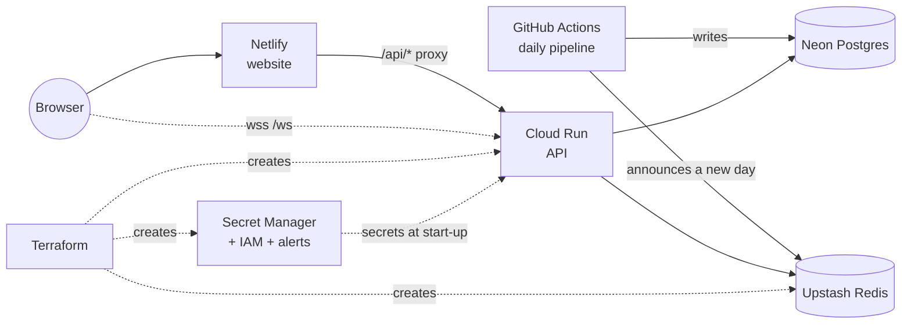

# Setup guide

How to stand up the whole system from nothing: the database, the pipeline, the API on Google Cloud, the site on Netlify, and the pieces that connect them. It's written so someone who has never used Terraform, Cloud Run or Redis can follow it, and it ends with a verification checklist and the problems that actually came up while building this.

For how the parts work once they're running, see [architecture.md](architecture.md) and [infrastructure.md](infrastructure.md). To run everything on your own machine instead, see [development.md](development.md).

## 1. What you're building



| Piece | What it is | Who creates it |
|---|---|---|
| **Neon** | Hosted Postgres (with the pgvector extension). The single source of truth for stories, briefs and embeddings. | You, in the Neon console |
| **Upstash Redis** | Hosted Redis: a shared in-memory cache, rate-limit counters and a message channel. Data here can be lost without harm. | Terraform |
| **Cloud Run** | Google's service for running a container without managing servers. It runs the API and scales to zero when idle. | Terraform |
| **Secret Manager** | Stores the database URL, Voyage key and Redis URL so they never enter code or images. | Terraform creates the entries; you add two values |
| **Netlify** | Hosts the website and proxies `/api/*` to Cloud Run. | You, in the Netlify dashboard |
| **GitHub Actions** | CI, the API deploy (this repo) and the daily data job (pipeline repo). | The workflow files; you set variables and secrets |

Two ideas explain most of the setup:

- **Terraform** describes cloud resources in `.tf` files and creates them for you. It records what it made in a *state file*, kept in a private Cloud Storage bucket. See [infrastructure.md](infrastructure.md).
- **Secrets are added by hand, never committed.** Terraform makes empty placeholders, and you put the real value in as a new version.

## 2. Accounts and tools

| You need | Notes |
|---|---|
| A **Google Cloud project** with a billing account linked | Cloud Run requires billing even inside the free tier. |
| A **Neon** account and project | The free plan is enough. |
| An **Upstash** account | Plus a *Management API* key (Account → Management API). Terraform uses it to create the database. |
| A **Netlify** account | Connect it to this GitHub repository. |
| A **GitHub** account, with this repo and the pipeline repo | Forks are fine. |
| An **OpenRouter** API key | Free. For the daily brief. |
| A **Voyage AI** API key (optional) | For search and related coverage. Add a payment method or the rate limit is 3 requests a minute. See [costs.md](costs.md). |
| `gcloud`, `terraform` (1.6 or newer), `git`, Node.js 22+, Python 3.12+ | Install Terraform from HashiCorp's own apt repository rather than the Snap package, which needs classic confinement. |

## 3. Database: Neon

1. **Create a project** in the Neon console. Note the connection details; the default role is the **owner** (for example `neondb_owner`). The owner can write and delete, so only the pipeline ever gets it.
2. **Create the schema.** For a new database, run `db/schema.sql` from the pipeline repo against the owner connection string. For an existing one, apply the files in `db/migrations/` in order (take a Neon branch first: migration 002 deletes duplicate links). Details are in the pipeline's [db.md](../trump-of-the-day-server/docs/db.md).
3. **Create the read-only role with plain SQL.** The API connects as `news_readonly`, which can only `SELECT` from `news` and `daily_digest`:

   ```sql
   CREATE ROLE news_readonly WITH LOGIN PASSWORD '<long random password>';
   GRANT USAGE ON SCHEMA public TO news_readonly;
   GRANT SELECT ON news, daily_digest TO news_readonly;
   ```

   Don't create this role in the Neon console, API or CLI. Roles made there are added to `neon_superuser` automatically, with permissions that can't be removed afterwards. Roles made by SQL start with nothing.
4. **Build the API's connection string.** The Neon *Connect* dialog may only offer the owner role, because roles created by SQL often aren't listed. Take the pooled string it gives you and change two things: the user (`news_readonly`) and the password (the one from step 3). It looks like:

   ```text
   postgresql://news_readonly:<password>@<pooled-host>/neondb?sslmode=require
   ```

   Use the pooled host (the name contains `-pooler`). If the dialog adds `channel_binding=require`, remove it; the Node driver doesn't need it.

If a read-only URL was ever compiled into a public website bundle, treat that password as leaked and rotate it with `ALTER ROLE news_readonly WITH PASSWORD '...'`.

## 4. Google Cloud: log in and create the state bucket

```bash
gcloud auth login
gcloud auth application-default login
gcloud config set project YOUR_PROJECT_ID
gcloud auth application-default set-quota-project YOUR_PROJECT_ID
```

These are **two separate logins**. `gcloud auth login` is for the `gcloud` command. `gcloud auth application-default login` creates the credentials Terraform uses. Setting the quota project stops a warning and lets the billing-budget API work.

Terraform needs somewhere to keep its state before it can manage anything, so you create that bucket by hand. Bucket names are unique across all of Google Cloud:

```bash
gcloud storage buckets create gs://YOUR-STATE-BUCKET --location=us-central1 --uniform-bucket-level-access --project=YOUR_PROJECT_ID
gcloud storage buckets update gs://YOUR-STATE-BUCKET --versioning
```

The state contains the Redis password, so keep the bucket private. Versioning lets you recover an earlier state.

## 5. Terraform: create the cloud resources

Work in `infra/gcp`.

1. **Backend config.** Copy `backend.hcl.example` to `backend.hcl` and put your bucket name in it. The file is gitignored.
2. **Variables.** Create `terraform.tfvars` (also gitignored):

   ```hcl
   project_id         = "your-project-id"
   site_origins       = ["https://your-site.netlify.app", "https://your-domain.example"]
   billing_account_id = "XXXXXX-XXXXXX-XXXXXX"   # gcloud billing accounts list
   alert_email        = "you@example.com"
   budget_usd         = 5
   ```

   `site_origins` is the list of websites allowed to open the live-update WebSocket. Set `github_repository` too if your repo isn't `divij-pawar/trump-of-the-day`; it limits which repository may deploy.
3. **Upstash credentials**, in your shell only:

   ```bash
   export UPSTASH_EMAIL=your-upstash-email UPSTASH_API_KEY=your-management-api-key
   ```
4. **Run it:**

   ```bash
   terraform init -backend-config=backend.hcl
   terraform plan
   terraform apply
   ```

   Read the plan before you type `yes`. It's safe to run `apply` again after a failure: Terraform skips what it already created. The Cloud Run service starts on Google's placeholder "hello" image until the first deploy.

What it creates: API enablement, an Artifact Registry repository for images, the Secret Manager entries (`database-url` and `voyage-api-key` as placeholders, `redis-url` filled in), the runtime and deploy service accounts, Workload Identity Federation for GitHub, the Cloud Run service, the Upstash database, a billing budget with email alerts, and an uptime check with an alert. Full detail is in [infrastructure.md](infrastructure.md).

A budget is **an alert, not a cap**. The real limit on spend is `max_instances` (2 by default) on the Cloud Run service.

## 6. Put the real secrets in

Terraform made empty secrets. Add the values as **new versions** in the Secret Manager console (Security → Secret Manager → the secret → *New version*), so nothing passes through your shell history:

| Secret | Value |
|---|---|
| `trump-of-the-day-api-database-url` | The `news_readonly` connection string from step 3 |
| `trump-of-the-day-api-voyage-api-key` | Your Voyage key, or leave the placeholder to disable search |

Check that the newest version is the one you meant, and disable older ones. The API reads `latest` each time an instance starts, so add secrets **before** deploying, or redeploy afterwards.

## 7. GitHub: variables and the first deploy

In this repository, **Settings → Secrets and variables → Actions → Variables**, add these five from `terraform output`:

| Variable | Terraform output |
|---|---|
| `GCP_PROJECT_ID` | your project ID |
| `GCP_REGION` | `us-central1` |
| `GCP_WORKLOAD_IDENTITY_PROVIDER` | `workload_identity_provider` |
| `GCP_DEPLOY_SERVICE_ACCOUNT` | `deploy_service_account` |
| `GCP_IMAGE_REPOSITORY` | `image_repository` |

They are identifiers, not secrets, so they go on the **Variables** tab. Until they exist, the deploy workflow is skipped.

Push the code (the pipeline repo first, because this repo's submodule pointer must exist there). CI runs, then **Deploy (GCP)** builds the image, rolls out a new Cloud Run revision and smoke-tests it. You can also start it from the Actions tab.

The smoke test calls `/livez` and `/readyz`. It uses `/livez`, not `/healthz`, because Cloud Run's front end answers `/healthz` itself with a 404 for outside requests. See [infrastructure.md](infrastructure.md#health-checks).

## 8. Netlify

1. Create a site from this repository. `netlify.toml` already holds the build command and headers.
2. In **Site configuration → Environment variables**, set both from `terraform output netlify_env`:

   | Variable | Value |
   |---|---|
   | `API_ORIGIN` | the Cloud Run URL (`https://…run.app`) |
   | `VITE_WS_URL` | the same host as `wss://…run.app/ws` |

   `API_ORIGIN` is used at build time to write the `/api/*` proxy rule, and the build fails without it, so a site with no API behind it is never published. `VITE_WS_URL` is compiled into the frontend because Netlify can't proxy WebSockets.
3. Delete `VITE_NEON_NEWS_URL` if the site used to have it.
4. Trigger a deploy (**Deploys → Trigger deploy → Clear cache and deploy site**). Variables only apply to new builds.
5. Make sure the site's address is in `site_origins` in `terraform.tfvars`, and re-run `terraform apply` if you add one.

The pipeline repository is a submodule with an HTTPS URL, so Netlify can clone it without a key.

## 9. The pipeline

In the **pipeline repository**, **Settings → Secrets and variables → Actions → Secrets**:

| Secret | Value |
|---|---|
| `DATABASE_URL` | The Neon **owner** connection string (the pipeline writes) |
| `OPENROUTER_API_KEY` | For the daily brief |
| `VOYAGE_API_KEY` | For embeddings (optional) |
| `UPSTASH_REDIS_REST_URL` | `terraform output upstash_rest_url` |
| `UPSTASH_REDIS_REST_TOKEN` | `terraform output -raw upstash_rest_token` |

The Upstash pair lets the pipeline clear the API's cache and trigger live updates. Without them the daily run still works; pages just refresh when their cache expires. The pipeline's own [setup](../trump-of-the-day-server/docs/setup.md) covers the schedule, the image build and the first run.

Fill in an existing archive once, from your own machine, in the pipeline directory with `DATABASE_URL` set to the owner string and `VOYAGE_API_KEY` exported:

```bash
python insert_news.py rescore
python insert_news.py backfill-embeddings
python insert_news.py enrich 2026-11-01 2026-11-18
```

`rescore` fills relevance scores, `backfill-embeddings` embeds each day's 50 top-ranked stories that have no embedding yet (set `EMBED_TOP_PER_DAY` to change that; `0` embeds everything), and `enrich` writes briefs for past days. All three are safe to repeat. Run `rescore` first, because the embedding limit ranks by that score.

## 10. Verify

| Check | Expected |
|---|---|
| `curl https://<cloud-run-host>/readyz` | `{"status":"ready","checks":{"db":true,"redis":true,"live":true},...}` |
| `curl https://<cloud-run-host>/api/dates/latest` | `{"date":"<the latest day>"}` |
| Open the site | The calendar, the day's brief with numbered citations and ranked stories |
| Open the browser's network tab | `/api/...` requests go to your own site and return 200 |
| Search for a topic | Results appear (503 means the Voyage key isn't set) |
| Run the pipeline (pipeline repo → Actions → "Run Docker image for Daily News Job" → Run workflow) | An open tab updates itself when the day is processed |
| Cloud Monitoring | The uptime check is green after the first 15-minute interval |

## 11. Troubleshooting

These all happened during the first setup.

| Symptom | Cause and fix |
|---|---|
| `terraform init`: "Failed to read file backend.hcl" | The file doesn't exist. Copy `backend.hcl.example` to `backend.hcl`. |
| `terraform init`: "could not find default credentials" | Run `gcloud auth application-default login`. |
| `terraform init`: 403 on a bucket named `my-tf-state-bucket` | `backend.hcl` still has the placeholder. Put your real bucket name in. |
| `gcloud storage buckets create`: "no active account" or "no valid credentials" | Run `gcloud auth login`. It is separate from the application-default login. |
| Warning about a "quota project" | Run `gcloud auth application-default set-quota-project YOUR_PROJECT_ID`. |
| `terraform apply`: Upstash `401 Unauthorized` | `UPSTASH_EMAIL` or `UPSTASH_API_KEY` is unset, wrong, or isn't a *Management API* key. Export them in the same shell and re-run; Terraform picks up where it stopped. |
| A pasted `read -rs` prompt returns instantly and a secret ends up containing the command text | The clipboard held the command, not the value. Copy the value first, or add the secret in the Secret Manager console. |
| The database secret logs in as `neondb_owner` | The Connect dialog gave the owner string. Build the `news_readonly` string by hand (step 3.4) and disable the owner version. |
| The Deploy (GCP) workflow shows **skipped** | The five `GCP_*` repository variables aren't set, or they're on the Secrets tab or the wrong repository. |
| The smoke test fails with `404` on `/healthz` | Cloud Run's front end answers that path. Use `/livez` (this repo already does). |
| The Cloud Run URL shows a "Congratulations" page | The placeholder image is still running. The deploy hasn't succeeded yet. |
| `backfill-embeddings`: `RateLimitError`, 3 RPM | Voyage limits accounts with no payment method. Add one in the Voyage dashboard; the backfill costs a few cents. |
| The site still shows the old version | Netlify's `API_ORIGIN` isn't set (the build fails), or the site wasn't rebuilt after setting it. |
| Live updates don't connect | The page's origin isn't in `site_origins`, or `VITE_WS_URL` is missing from the Netlify build. |
| `/api/search` returns 503 | `VOYAGE_API_KEY` is unset or still the placeholder. Add it and redeploy. |
| The daily run stopped after about 60 days of no commits | GitHub disables scheduled workflows on inactive repositories. Re-enable it in the Actions tab. |

## 12. Taking it down

`terraform destroy` in `infra/gcp` removes everything Terraform created, including the Upstash database. It doesn't touch Neon, Netlify, the state bucket or GitHub settings. The AWS stack in `infra/aws` is designed to be applied for a demo and destroyed afterwards ([infrastructure.md](infrastructure.md)).
